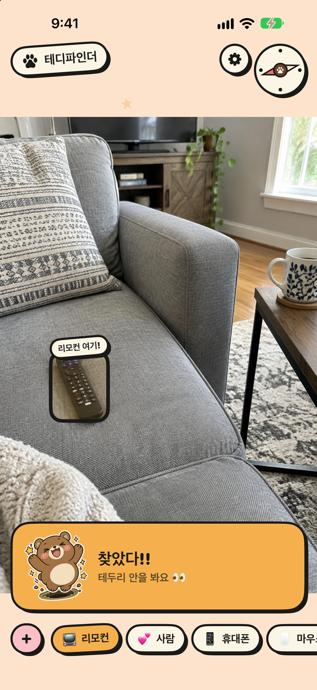
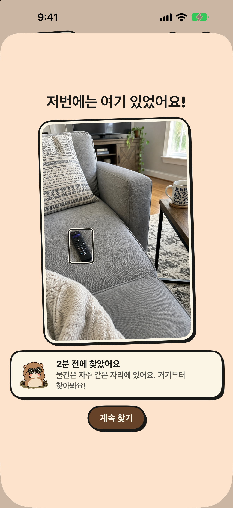
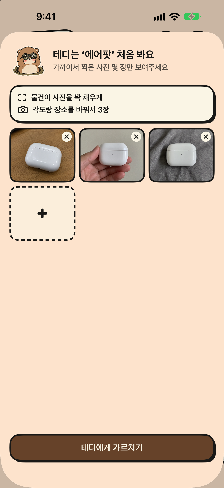

# 🧸 TeddyFinder 테디파인더

카메라로 방을 비추면 곰돌이 테디가 리모컨, 휴대폰, 에어팟 같은 물건을 찾아 주는 iOS 앱입니다.
모든 인식은 아이폰 안에서만 이루어지고, 네트워크 연결이나 데이터 수집이 없습니다.

<p>  </p>

## 소개 영상
[숏폼 영상 보기 (28초)](Design/video/teddyfinder_short.mp4). 등장인물은 모두 AI로 만든 가상 인물입니다.

## 기능
- **실시간 찾기**: YOLOv8n(Core ML)으로 COCO 물건(리모컨, 휴대폰, 컵 …)을 찾고, 박스·나침반·폭죽으로 알려 줍니다.
- **사진으로 가르치기**: 모델이 모르는 물건(에어팟, 차 키)은 사진 3장으로 등록합니다. Vision feature print로 비교합니다.
- **사람 찾기**: 얼굴 인식 없이, 등록한 옷차림으로 화면 속 사람 중 한 명을 고릅니다.
- **마지막으로 찾은 장소**: 찾은 순간의 장면을 기기 안에 저장해 '못 찾겠어요'에서 보여 줍니다.
- 한국어 / English

## 빌드
```bash
brew install xcodegen
xcodegen generate
open TeddyFinder.xcodeproj
```
Xcode 27, iOS 17 이상. `project.yml`의 `DEVELOPMENT_TEAM`, `PRODUCT_BUNDLE_IDENTIFIER`를 본인 것으로 바꾸세요.

## 확인용 테스트 (Mac)
```bash
swiftc Sources/Tracker.swift Checks/tracker/main.swift -o /tmp/tc && /tmp/tc
swiftc Sources/Items.swift Checks/items/main.swift -o /tmp/ic && /tmp/ic
swiftc -O Sources/Tracker.swift Sources/Matcher.swift Checks/matcher/main.swift -o /tmp/mc && /tmp/mc
```

## 구조
| 파일 | 역할 |
|---|---|
| `Sources/App.swift` | 메인 화면, 스플래시, 팔레트, 나침반, 폭죽 |
| `Sources/Detector.swift` | YOLO 탐지 + 가르친 물건 매칭 |
| `Sources/Tracker.swift` | 흔들리는 탐지 → 안정된 '찾음' 상태 |
| `Sources/Matcher.swift` | 사진으로 가르친 물건·사람 비교 |
| `Sources/Items.swift` | 물건 목록, 이름 → 물건 연결 |
| `Sources/AddItem.swift` | '+' 추가 / 가르치기 화면 |
| `Sources/Settings.swift` | 설정 |
| `docs/` | 개인정보 처리방침, 고객 지원 (GitHub Pages) |
| `Design/gen.sh` | 마스코트·아이콘 이미지 생성 스크립트 |
| `Design/video/` | 숏폼 영상 조립 스크립트(`build.sh`), 캡션, 배경음 생성(`bgm.py`) |

## 라이선스
[GNU AGPL-3.0](LICENSE). 포함된 탐지 모델 [Ultralytics YOLOv8n](https://github.com/ultralytics/ultralytics)이 AGPL-3.0이라 앱 전체를 같은 라이선스로 공개합니다.
마스코트·아이콘 이미지는 OpenAI 이미지 모델로 생성했습니다.
